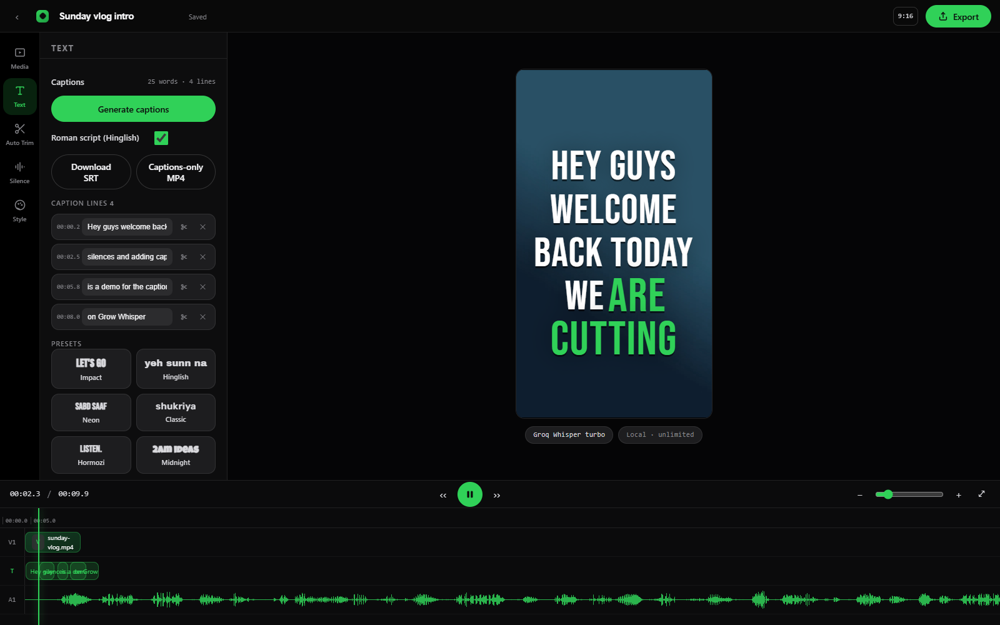
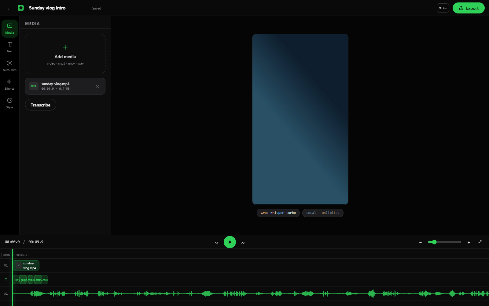
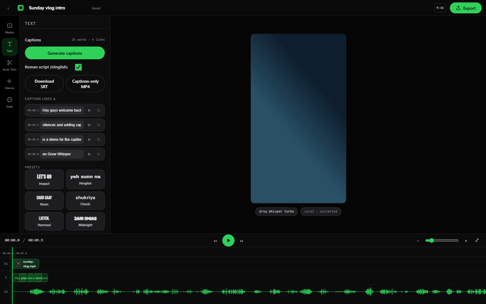
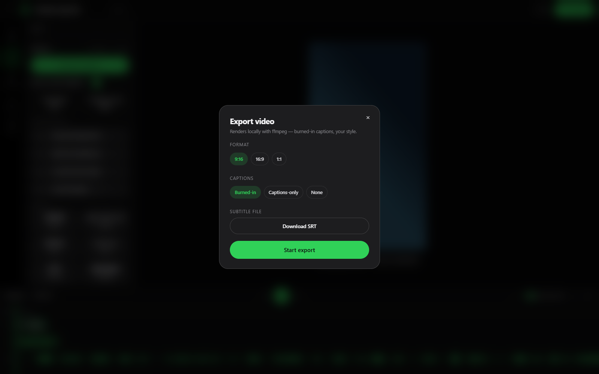
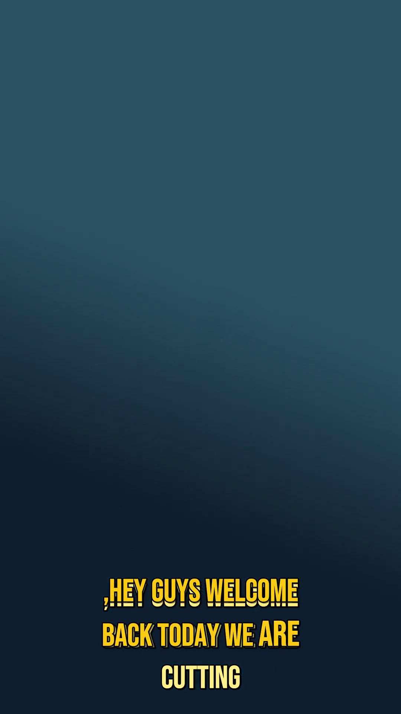

# Caption Studio

A local, single-user, word-timed caption editor for short-form video — feature-parity with commercial caption editors, plus Groq-powered transcription and captioning. Everything runs on your machine: no accounts, no cloud storage, no build step, zero npm dependencies.

## What it does

- **Upload** any video or MP3 (drag-and-drop or Add media).
- **Transcribe** with Groq `whisper-large-v3-turbo` (word-level timestamps). Hindi/Telugu/other Indian languages work — captions come out Devanagari; flip on **Roman script (Hinglish)** and a Qwen 3.8 pass transliterates per word, preserving timestamps.
- **Style** captions live: 6 presets (Impact, Hinglish, Neon, Classic, Hormozi, Midnight), font family, size, accent color, uppercase.
- **Auto Trim**: LLaMA-qwen pass removes fillers / repetitions / off-topic (optional), plus **silence detection** from the waveform (threshold + min length) — cuts applied at export.
- **Caption editor**: inline line editor (split at largest gap / delete / retype, timestamps preserved), Roman transliteration keeps word timings.
- **Export** with burned-in captions to 9:16 / 16:9 / 1:1 via a local ffmpeg worker (black canvas with animated word-level captions, AAC stereo), **Captions-only** black-canvas mode, or plain **SRT** download.
- Auto-save, SQLite persistence, projects persist across sessions.

## Screenshots











## Quick start

Requirements: **Node.js ≥ 24.15** (for built-in `node:sqlite`) and **ffmpeg + ffprobe** on PATH (Windows: `winget install Gyan.FFmpeg`).

```sh
# 1) configure
cp .env.example .env
# add your Groq API key (https://console.groq.com/keys) to GROQ_API_KEY

# 2) run
npm start          # or: node server.js
# open http://localhost:4269
```

A Groq API key is required — transcription always goes through `whisper-large-v3-turbo` on Groq; there is no local/offline or demo fallback.

## Layout

```
server.js     HTTP API + Range media streaming (raw uploads, zero deps)
db.js         node:sqlite schema (projects, media, transcriptions, captions, silence_cuts, export_jobs)
export.js     ffmpeg render worker (trim concat → scale/crop → ASS burn-in → H.264)
subtitles.js  ASS generator: word-level pop, wrapping, Hinglish-safe fonts
groq.js       Groq client (multipart whisper + chat)
public/       UI (index.html + styles.css + app.js) — Apple-dark minimal theme
assets/fonts/ OFL fonts used for burn-in (Bebas Neue, Anton)
data/         runtime data (SQLite db, uploaded media, exports) — gitignored
```

## Notes & limits

- **Brand**: original mark and name ("Caption Studio"); a clean-room reimplementation, built from a written product spec.
- **Windows fonts**: burn-in resolves Nirmala UI automatically for Devanagari captions; Roman text uses embedded Bebas/Anton.
- Word timestamps are preserved end-to-end, including after Hinglish transliteration (per-word) and silence cuts.
- The captions overlay reaches the screen through ffmpeg/libass; SRT passes through plain text.

## Keyboard shortcuts

`Space` play/pause · `←/→` ±5s · `1–5` switch tools (Media/Text/Auto Trim/Silence/Style) · `B` back to projects · `N` new project · `Esc` close export

## What's deliberately missing (vs a SaaS)

Auth, billing/credits, cloud rendering, device limits, share links, onboarding, affiliates, mobile — those are business shells; add them by swapping the SQLite layer for your DB when you productize.
